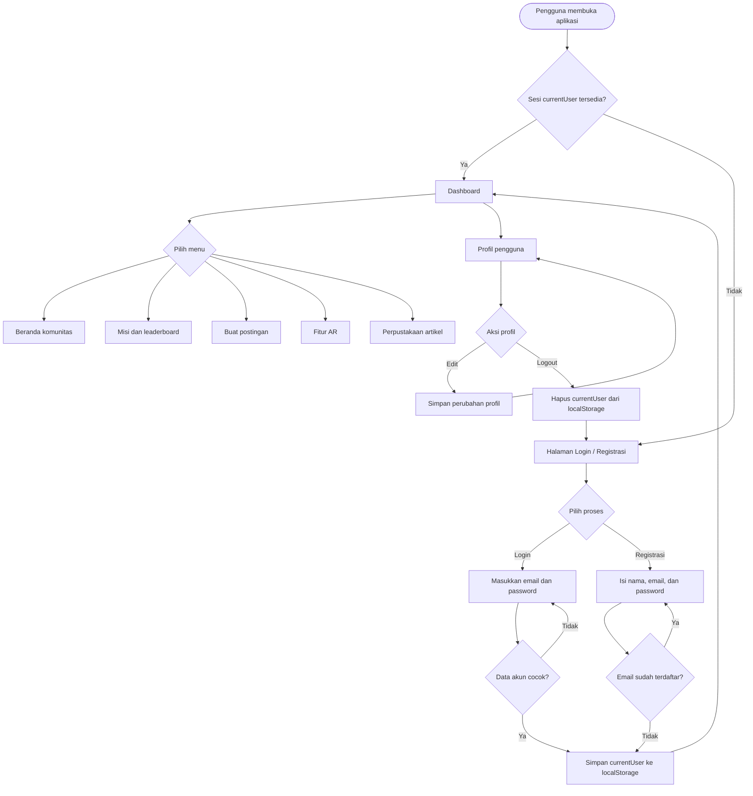
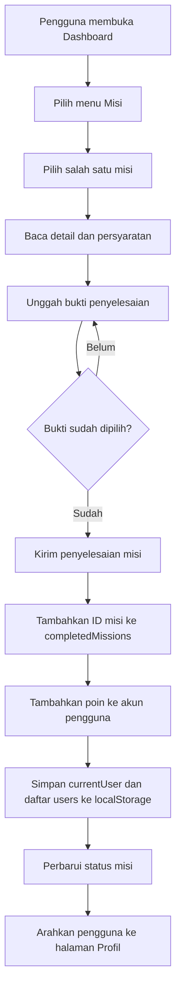
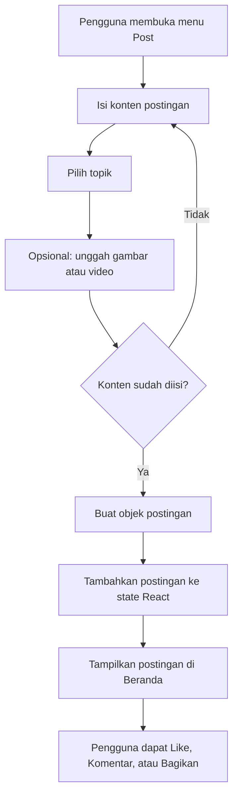
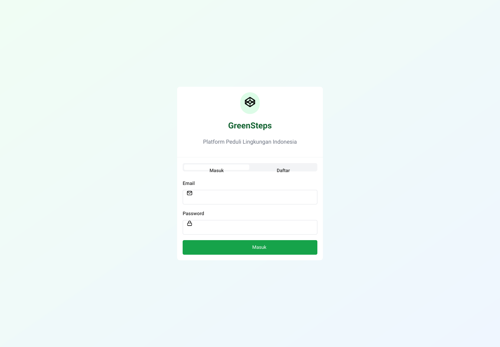
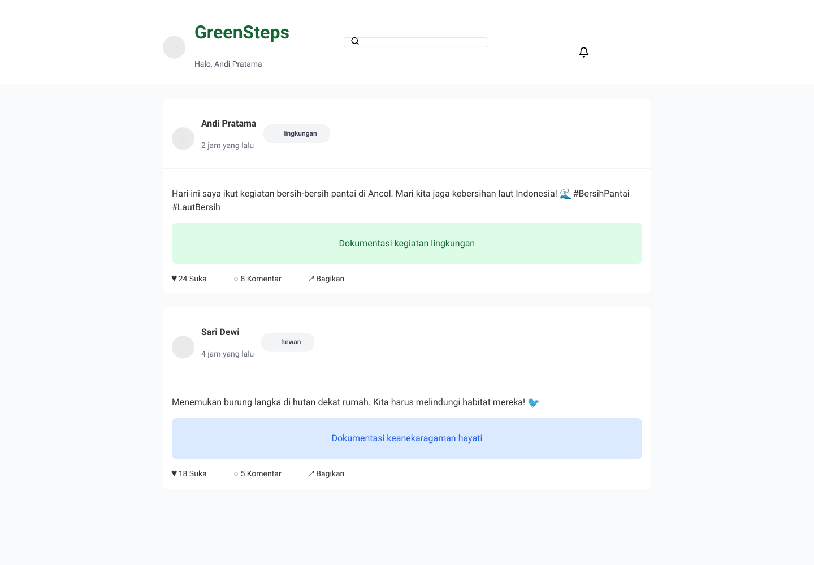
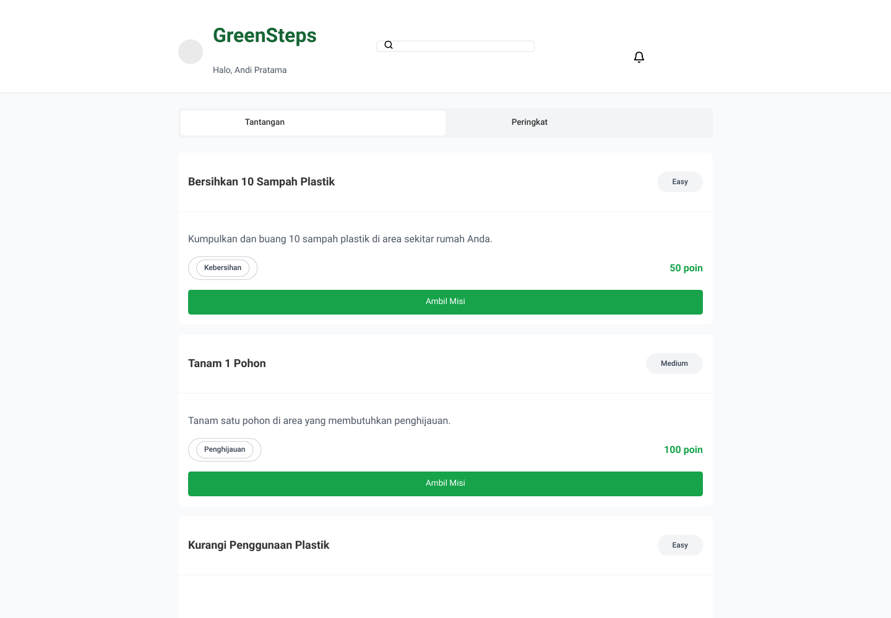

# GreenSteps 🌱

**Platform Peduli Lingkungan Indonesia**

GreenSteps adalah aplikasi web komunitas yang mengajak pengguna untuk lebih peduli terhadap lingkungan. Pengguna dapat berbagi aktivitas dan informasi lingkungan, mengikuti misi, mengumpulkan poin, melihat peringkat kontributor, serta membaca artikel edukasi.

Project ini dibangun menggunakan Next.js, React, TypeScript, dan Tailwind CSS. Implementasi yang tersedia berfokus pada antarmuka dan interaksi frontend. Data pengguna disimpan di `localStorage`, sedangkan sejumlah konten dashboard masih menggunakan data contoh yang didefinisikan di dalam kode.

## Tujuan Project

- Menyediakan ruang komunitas untuk berbagi informasi dan aktivitas lingkungan.
- Mendorong tindakan sederhana melalui misi lingkungan dan sistem poin.
- Memberikan akses ke artikel edukasi tentang lingkungan Indonesia.
- Menampilkan kontribusi pengguna melalui profil dan leaderboard.
- Menyediakan gambaran awal fitur pembelajaran berbasis AR.

## Fitur Utama

| Fitur | Deskripsi | Implementasi pada kode |
|---|---|---|
| Login dan registrasi | Pengguna dapat masuk atau membuat akun baru. | Menggunakan data pengguna yang disimpan di `localStorage`. |
| Beranda komunitas | Menampilkan feed aktivitas dan informasi lingkungan dari pengguna. | Menggunakan data contoh dan state React. |
| Buat postingan | Pengguna dapat menulis konten, memilih topik, dan menambahkan media. | Postingan baru masuk ke state feed selama sesi aplikasi berjalan. |
| Like dan komentar | Pengguna dapat memberi suka dan menambahkan komentar pada postingan. | Interaksi dikelola melalui state React. Informasi like pengguna juga disimpan di `localStorage`. |
| Bagikan konten | Pengguna dapat membagikan postingan melalui beberapa platform. | Menggunakan URL berbagi platform atau menyalin tautan. |
| Misi lingkungan | Pengguna dapat memilih misi dan mengirim bukti penyelesaian. | File bukti wajib dipilih sebelum misi dikirim. Poin dan daftar misi selesai diperbarui pada data pengguna. |
| Leaderboard | Menampilkan peringkat kontributor berdasarkan jumlah poin. | Data pengguna diurutkan berdasarkan poin yang tersimpan di `localStorage`. |
| Pencarian | Mencari postingan, pengguna, atau artikel. | Pencarian dilakukan pada data contoh dan data pengguna lokal. |
| Notifikasi | Menampilkan contoh notifikasi aktivitas pengguna. | Notifikasi masih berupa data contoh di frontend. Pengguna dapat menandai notifikasi sebagai sudah dibaca. |
| Perpustakaan artikel | Menampilkan artikel edukasi lingkungan. | Artikel disimpan sebagai data statis dan dapat difilter berdasarkan provinsi serta kategori. |
| AR dan edukasi interaktif | Menampilkan konsep simulasi pemungutan sampah, pemindaian sampah, dan tur virtual hutan. | Kartu antarmuka tersedia. Tautan integrasi eksternal masih berupa placeholder. |
| Profil pengguna | Menampilkan informasi, statistik, postingan, dan pencapaian pengguna. | Pengguna dapat mengubah informasi profil dan foto, lalu menyimpan perubahan ke `localStorage`. |

## Teknologi yang Digunakan

| Teknologi | Penggunaan |
|---|---|
| Next.js 15 | Framework aplikasi web dan routing dengan App Router. |
| React 19 | Membangun antarmuka berbasis komponen. |
| TypeScript | Menambahkan tipe data pada komponen dan logika aplikasi. |
| Tailwind CSS | Mengatur layout, warna, spacing, dan tampilan responsif. |
| Radix UI | Menyediakan primitive komponen antarmuka yang aksesibel. |
| Lucide React | Menyediakan ikon antarmuka. |
| Browser `localStorage` | Menyimpan akun demo, sesi pengguna, poin, dan preferensi/interaksi tertentu pada browser. |

## Struktur Project

```text
GreenSteps/
├── app/
│   ├── page.tsx                   # Halaman login dan registrasi
│   ├── layout.tsx                 # Root layout dan metadata aplikasi
│   ├── globals.css                # Global stylesheet untuk Next.js
│   ├── dashboard/
│   │   ├── page.tsx               # Dashboard dan fitur komunitas
│   │   └── loading.tsx            # Tampilan loading dashboard
│   ├── profile/
│   │   └── page.tsx               # Halaman profil pengguna
│   └── html-templates/
│       ├── login.html             # Template HTML login/registrasi
│       └── dashboard.html         # Template HTML dashboard
├── components/
│   ├── theme-provider.tsx         # Provider tema
│   └── ui/                        # Komponen UI reusable berbasis Radix UI
├── hooks/
│   ├── use-mobile.tsx             # Hook deteksi tampilan mobile
│   └── use-toast.ts               # Hook notifikasi toast
├── lib/
│   └── utils.ts                   # Utility/helper class CSS
├── public/
│   ├── index.html                 # File HTML statis
│   ├── styles.css                 # Stylesheet untuk template HTML
│   └── placeholder.*              # Aset placeholder
├── styles/
│   └── globals.css                # Global stylesheet alternatif
├── screenshots/                  # Screenshot preview untuk dokumentasi
├── components.json               # Konfigurasi komponen UI
├── next.config.mjs               # Konfigurasi Next.js
├── package.json                  # Dependencies dan scripts
├── pnpm-lock.yaml                # Lockfile pnpm yang disertakan
├── postcss.config.mjs             # Konfigurasi PostCSS
├── tailwind.config.ts             # Konfigurasi Tailwind CSS
├── tsconfig.json                  # Konfigurasi TypeScript
└── .gitignore                     # File/folder yang diabaikan Git
```

## Struktur Halaman dan Routing

Aplikasi Next.js menggunakan App Router. Halaman utama aplikasi berasal dari file di dalam folder `app/`.

| URL | File sumber | Fungsi |
|---|---|---|
| `/` | `app/page.tsx` | Login dan registrasi pengguna. |
| `/dashboard` | `app/dashboard/page.tsx` | Beranda, misi, posting, AR, perpustakaan artikel, pencarian, dan notifikasi. |
| `/profile` | `app/profile/page.tsx` | Profil, statistik, pencapaian, edit profil, dan logout. |

### Catatan tentang Template HTML

Folder `app/html-templates/` berisi dua template HTML terpisah, yaitu `login.html` dan `dashboard.html`. Keduanya merupakan template/prototipe HTML yang menggunakan `public/styles.css` dan JavaScript di dalam file HTML.

Template tersebut bukan route yang otomatis digunakan oleh Next.js App Router. Implementasi utama aplikasi menggunakan file React/TypeScript berikut:

- `app/page.tsx`
- `app/dashboard/page.tsx`
- `app/profile/page.tsx`

Karena itu, terdapat beberapa detail yang berbeda antara template HTML dan implementasi React. Contohnya, template HTML mengarahkan pengguna ke `/dashboard.html`, sedangkan aplikasi Next.js menggunakan route `/dashboard`.

## Flowchart Alur Pengguna

Diagram berikut menggambarkan alur utama aplikasi berdasarkan implementasi frontend.



## Workflow Fitur Misi

Alur penyelesaian misi lingkungan memiliki tahapan berikut:



## Workflow Postingan Komunitas



## Alur Penyimpanan Data

Implementasi saat ini menggunakan penyimpanan sisi browser dan data contoh di frontend.

| Data | Sumber/penyimpanan | Keterangan |
|---|---|---|
| Akun pengguna | `localStorage` dengan key `users` | Berisi akun demo dan akun yang didaftarkan pengguna. |
| Sesi pengguna | `localStorage` dengan key `currentUser` | Dipakai untuk memeriksa sesi pada halaman dashboard dan profil. |
| Poin dan misi yang selesai | Properti pada `currentUser` dan daftar `users` | Diperbarui ketika pengguna mengirim bukti penyelesaian misi. |
| Preferensi like | Properti `likedPosts` dan `likedComments` pada data pengguna | Disimpan pada `localStorage`. |
| Postingan dan komentar | State React dan data contoh | Postingan baru/komentar tidak disimpan ke database. Sebagian data dapat kembali ke data awal setelah halaman dimuat ulang. |
| Daftar misi | State React dan data contoh | Status misi yang diperbarui pada sesi aplikasi tidak menggunakan backend. |
| Artikel dan notifikasi | Data statis di file dashboard | Tidak diambil dari API atau database. |

## Cara Menjalankan Project

### 1. Persyaratan

- Node.js terpasang pada komputer.
- npm terpasang bersama Node.js.
- Terminal atau command prompt.

### 2. Install Dependencies

Buka terminal pada folder utama project, lalu jalankan:

```bash
npm install
```

### 3. Jalankan Development Server

```bash
npm run dev
```

Buka alamat berikut pada browser:

```text
http://localhost:3000
```

### 4. Build untuk Production

```bash
npm run build
npm start
```

## Akun Demo

Pada implementasi Next.js, aplikasi menginisialisasi akun contoh jika key `users` belum tersedia di `localStorage` browser.

| Field | Nilai |
|---|---|
| Email | `andi@example.com` |
| Password | `password123` |

Gunakan akun ini untuk mencoba alur login pada browser yang belum memiliki data GreenSteps sebelumnya. Jika `localStorage` sudah berisi data lama, akun demo belum tentu diinisialisasi ulang.

## Screenshot Preview

Screenshot berikut merupakan preview dari template HTML yang disertakan dalam repository. Preview dashboard dan misi menggunakan contoh konten pada project untuk memperlihatkan tampilan area yang pada template diisi melalui JavaScript. Gambar ini merupakan dokumentasi visual template, bukan bukti integrasi backend atau layanan eksternal.

### Login dan Registrasi



### Dashboard Komunitas



### Misi Lingkungan



Catatan: ZIP sumber tidak menyertakan file HTML profil terpisah. Halaman profil tersedia pada `app/profile/page.tsx`, sehingga tidak dibuat screenshot HTML profil yang seolah-olah berasal dari file yang tidak ada.

## Batasan Implementasi Saat Ini

- Belum terdapat backend API dan database server. Data demo disimpan di browser.
- Mekanisme login/registrasi hanya untuk demonstrasi frontend. Password disimpan di `localStorage`, sehingga tidak boleh digunakan untuk akun atau informasi pribadi yang sebenarnya.
- Data feed, artikel, misi, dan notifikasi masih banyak menggunakan data contoh yang ditulis langsung di frontend.
- Postingan dan komentar baru dikelola melalui state React dan belum memiliki persistensi database.
- Fitur AR, pemindaian sampah berbasis AI, serta tur virtual belum terintegrasi. Tautan pada tombol masih menggunakan URL placeholder.
- Tombol pengaturan profil seperti notifikasi, privasi, dan bantuan masih berupa elemen antarmuka dan belum memiliki alur pengaturan lengkap.
- Route proteksi menggunakan pemeriksaan `localStorage` di sisi client. Ini bukan sistem autentikasi yang aman untuk aplikasi production.

## Pengembangan Selanjutnya

Beberapa pengembangan yang dapat dipertimbangkan:

1. Menghubungkan aplikasi ke backend dan database untuk akun, posting, komentar, misi, artikel, serta notifikasi.
2. Mengimplementasikan autentikasi yang aman, validasi server-side, dan manajemen sesi.
3. Menambahkan persistensi postingan, komentar, dan riwayat aktivitas pengguna.
4. Mengintegrasikan layanan AR/AI yang sebenarnya dan mengganti URL placeholder.
5. Menambahkan pengujian fungsional dan pengujian responsivitas pada perangkat desktop maupun mobile.

---

**GreenSteps** — Mulai dari langkah kecil untuk lingkungan yang lebih baik. 🌱
